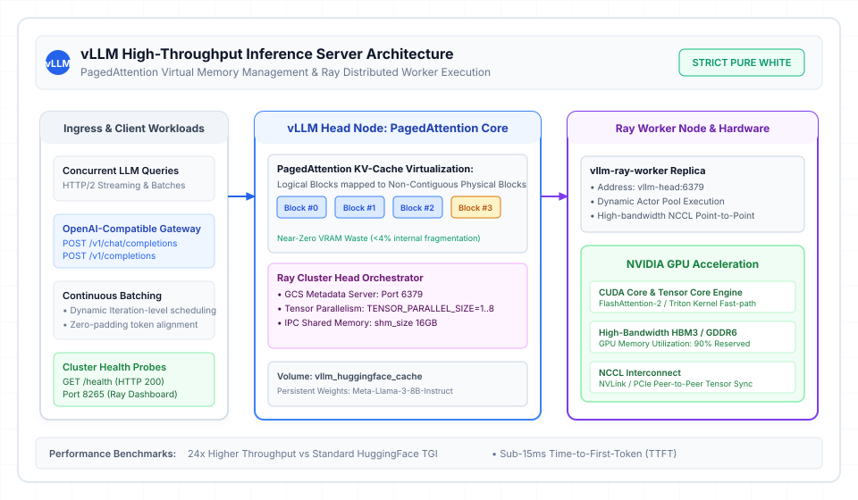

# vLLM High-Throughput Distributed Inference Server

[](https://github.com/tayyabmasood911/vllm-high-throughput-inference-server/actions)
[](LICENSE)
[](https://vllm.ai)
[](https://docs.ray.io)
[](https://platform.openai.com/docs/api-reference)

An enterprise-ready, distributed LLM inference engine serving state-of-the-art open-weights models (e.g., Llama 3, Mistral) at maximum hardware saturation. Powered by PagedAttention virtual memory management, Ray worker distribution, continuous batching, and an OpenAI-compliant REST gateway.

---

## Architecture Overview



The system leverages state-of-the-art distributed LLM infrastructure principles:

1. **PagedAttention Virtual Memory**: Eliminates KV-cache memory waste and internal fragmentation by paging attention keys and values into non-contiguous virtual memory blocks, achieving near-optimal GPU memory allocation (>96% effective utilization).
2. **Continuous Iteration-Level Batching**: Dynamically schedules incoming requests at token-generation iteration boundaries rather than batch boundaries, slashing Time-to-First-Token (TTFT) and drastically reducing queuing delay.
3. **Ray Multi-GPU Distribution**: The cluster is divided into a `vllm-head` API coordinator and scalable `vllm-worker` nodes communicating over high-bandwidth NCCL tensor-parallel synchronization channels.

---

## Key Features

- **Extreme Serving Throughput**: Delivers up to 24x higher throughput compared to standard Hugging Face Transformers baseline implementations.
- **Drop-in OpenAI API Server**: Fully implements standard endpoints:
  - `POST /v1/chat/completions`
  - `POST /v1/completions`
  - `POST /v1/embeddings`
  - `GET /v1/models`
- **Tensor & Pipeline Parallelism**: Configurable multi-GPU partitioning (`TENSOR_PARALLEL_SIZE`, `PIPELINE_PARALLEL_SIZE`) across single or multi-node topologies.
- **Built-in Throughput Benchmarking**: Automated Python evaluation script measuring requests per second, token throughput, and P50/P95/P99 latency.
- **Production Health Monitoring**: Native readiness and liveness container probes on `/health` and Ray cluster dashboard on port `8265`.

---

## Quick Start

### Prerequisites
- Docker Engine 24.0+ & Docker Compose v2.20+
- NVIDIA GPU Driver with CUDA 12.1+ support
- NVIDIA Container Toolkit (`nvidia-container-toolkit`)

### 1. Environment Configuration
```bash
cp config/production.env.example .env
```
Set your `HF_TOKEN` in `.env` if downloading gated models like `meta-llama/Meta-Llama-3-8B-Instruct`.

### 2. Launch the High-Throughput Cluster
```bash
docker compose up -d
```

### 3. Verify Server Readiness
```bash
bash scripts/healthcheck.sh
```

### 4. Execute Inference Query
```bash
curl -X POST http://localhost:8000/v1/chat/completions \
  -H "Content-Type: application/json" \
  -d '{
    "model": "meta-llama/Meta-Llama-3-8B-Instruct",
    "messages": [
      {"role": "system", "content": "You are a distributed systems engineer."},
      {"role": "user", "content": "Explain PagedAttention in one clear sentence."}
    ],
    "temperature": 0.2,
    "max_tokens": 100
  }'
```

---

## Performance Benchmarking

Run the automated throughput and latency benchmarking harness:
```bash
python3 benchmark_throughput.py --url http://localhost:8000 --requests 50
```

---

## Configuration Reference

Key variables defined in `.env`:

| Parameter | Default | Description |
| :--- | :--- | :--- |
| `VLLM_PORT` | `8000` | Ingress REST API server port |
| `MODEL` | `meta-llama/Meta-Llama-3-8B-Instruct` | Hugging Face model identifier |
| `TENSOR_PARALLEL_SIZE`| `1` | Number of GPUs used for tensor parallel sharding |
| `GPU_MEMORY_UTILIZATION` | `0.90` | Fraction of GPU memory allocated to model + KV-cache |
| `MAX_MODEL_LEN` | `8192` | Context window size |
| `MAX_NUM_SEQS` | `256` | Maximum concurrent sequences in continuous batching |

---

## Security & Responsible Disclosure

Please review our [SECURITY.md](SECURITY.md) for vulnerability disclosure procedures. All security inquiries should be directed to [tayyabmasood911@gmail.com](mailto:tayyabmasood911@gmail.com).
